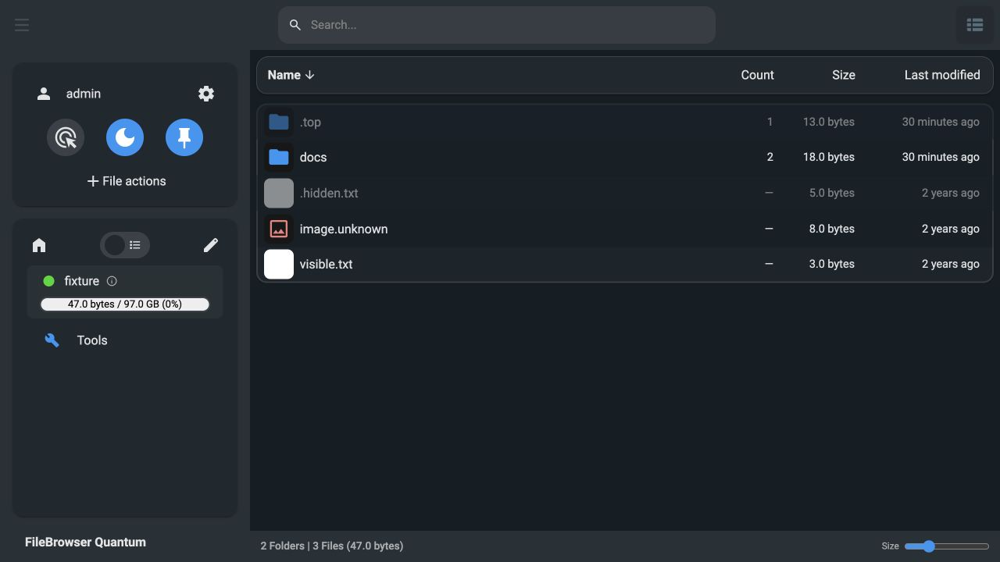

# PostgreSQL / size mode validation

Validation date: 2026-10-23 (Asia/Shanghai).

The full `_docker/Dockerfile` was built on an isolated Linux test host for
`linux/amd64`. Tests used a dedicated PostgreSQL 18 Alpine container and generated
fixture files in a temporary directory. Production storage/configuration was not mounted.

The published registry manifest was verified against the tested image.
The final image passed health, listing/counts, hidden entries, metadata reuse and
DSN redaction checks after the last build; its Docker health status is `healthy`.

## Automated checks

| Check | Result |
| --- | --- |
| Backend: `go test -race -timeout=120s ./...` with test PostgreSQL DSN | Passed |
| Shared SQLite/PostgreSQL contract: CRUD, bulk upsert, search/globs, scope filtering, counts, large sizes, cleanup, policy invalidation | Passed |
| Size mode metadata and hidden accounting at multiple depths | Passed |
| Folder count/size propagation, persistence and restore | Passed |
| Environment overrides and DSN redaction | Passed |
| Frontend: `npm run typecheck` | Passed |
| Frontend: `npm run lint` and targeted CSS lint | Passed |
| Frontend: `npm run i18n:check` | Passed |
| Frontend: `npm test` | 51 test files / 335 tests passed |
| Generated Swagger and config: `make generate-docs` | Passed |
| Deployment Compose: `docker compose -f docs/compose.pg.example.yaml config --quiet` with dummy validation secrets | Passed |

## Container and browser checks

The fixture has six files, including a dotfile, a top-level hidden directory,
a nested hidden directory, and PNG-header data under an unknown extension.
Logical size is 47 bytes, with four directories including the root.

* Health, page, listing, user and server-settings endpoints returned HTTP 200.
* Root returned `size: 47`, `fileCount: 6`.
* `docs/` returned `size: 18`, `fileCount: 2`; `.top/` returned 13 bytes / 1 file.
* All six files persisted as `blob`, with preview flags false. Their set
  modification timestamp (`1700000100`) and available creation times survived.
* Browsing detected types on demand; subsequent PostgreSQL inspection confirmed
  the size-only rows still had no persisted type/preview probes.
* Server settings response did not contain the test PostgreSQL password.
* Restart recovered health in 1.20 seconds on this **small fixture** and reused
  rows, sizes, counts and `last_updated` values unchanged.
* Browser list view showed `Name / Count / Size / Last modified`, directory
  recursive counts and an em dash for file rows.



These checks establish correctness on test data. They do not benchmark the
production storage or predict startup/scan time for large existing indexes.
The restart timing above must not be used as a production performance estimate.

Remote logs:

```text
/tmp/filebrowser-count-all-tests.log
/tmp/filebrowser-count-frontend-checks.log
/tmp/filebrowser-count-frontend-full-checks.log
/tmp/filebrowser-final-docker-build.log
/tmp/filebrowser-pg-push.log
```
