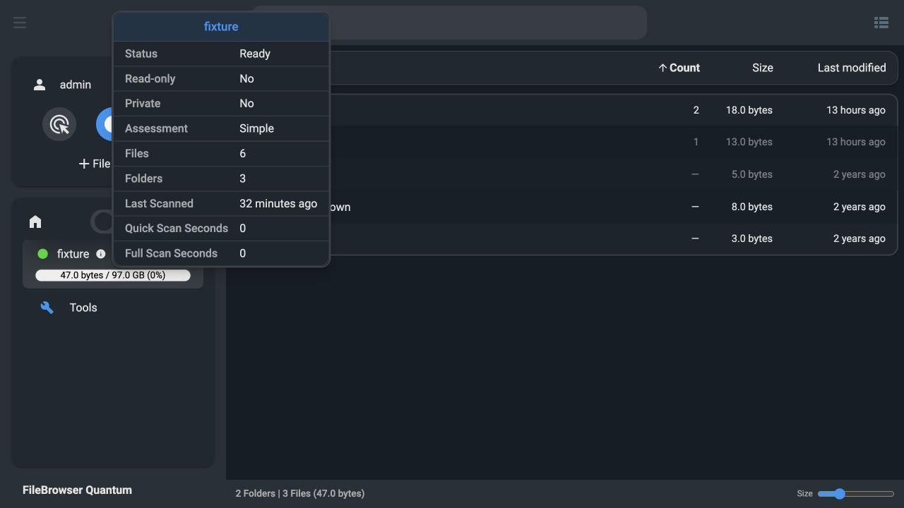

# 手动调度、扫描时间与 Count 排序验证（2026-10-24）

构建与运行均在独立 Linux 测试主机完成，使用生成的测试目录与 PostgreSQL 18 测试库。
镜像版本为 `pg-schedule`，平台 `linux/amd64`。

发布后的镜像清单摘要与验证镜像一致。

## 配置和调度

* 全局 YAML、全局环境变量、分数据源覆盖及缺省值均通过测试。
* 错误时长、小于一分钟的间隔、负数轮次及非整数环境变量被拒绝。
* 固定间隔绕过复杂度限制和 UTC 时间槽对齐，下一轮从完成时间计算。
* 测试覆盖 1、3、8 轮的完整/快扫切换、较长轮次重启恢复、缩短周期后到期完整扫描。
* 新目录补扫不提前重跑已有扫描器；调度变更不改变索引内容策略指纹。
* 每轮完成后，数据源卡片容量直接取内存中的根目录汇总，避免继续显示首次磁盘探测缓存的 0。

独立容器使用 `FILEBROWSER_INDEX_SCAN_INTERVAL=1m`、
`FILEBROWSER_INDEX_FULL_SCAN_EVERY=2`，实测结果：

| 步骤 | 结果 |
| --- | --- |
| 首次完整扫描 | 6 文件、47 字节；各扫描器下一轮在完成后 60–61 秒 |
| 第二轮快扫 | 扫描时间推进；无变化文件 SQL 行的 `last_updated` 完全不变 |
| 重启容器 | 保留上次扫描时间、预计下次扫描时间、完整扫描轮次及索引行 |
| 第三轮完整扫描 | 按时刷新文件索引行；仍为 6 文件、47 字节 |

临时容器、数据库和测试目录已清理。保留的回归测试容器已更新为最终镜像，
使用原来的 `auto` / `5` 配置，健康检查通过，6 文件 / 47 字节保持正确。

## 前端

* 346 项前端测试通过，包含秒时间戳的中英文显示、未知时间、数字 Count 排序、
  未知 Count、空目录、相同数量与置顶优先级。
* 类型检查、Biome/ESLint 和翻译键检查通过。
* 浏览器实际点击 Count：升序为 `.top=1, docs=2`，降序为 `docs=2, .top=1`。
* 刷新页面后仍保留 Count 降序。目录先于普通文件，普通文件按名称显示。
* 数据源卡片显示 `Last Scanned: 32 minutes ago`，与后端时间一致，不再是 56 年前。



## 后端检查

完整后端 `go test -race -p 1 -timeout=180s ./...` 通过，并包含 SQLite/PostgreSQL 合约测试。
首次与 Docker 编译并行运行时，已有认证耗时测试超过了 20% 时间差阈值；
构建结束后按包串行重跑通过，认证实现没有改动。
最终容量刷新修正后，索引、启动命令及 HTTP 包再次通过 race 测试。
完整 Docker 镜像构建成功。

远端证据：

```text
/tmp/filebrowser-scan-time-frontend-checks.log
/tmp/filebrowser-count-sort-frontend-checks.log
/tmp/filebrowser-schedule-all-tests-serial.log
/tmp/filebrowser-schedule-final-tests.log
/tmp/filebrowser-schedule-runtime.log
/tmp/filebrowser-schedule-runtime.json
/tmp/filebrowser-schedule-count-build.log
/tmp/filebrowser-schedule-push.log
```
